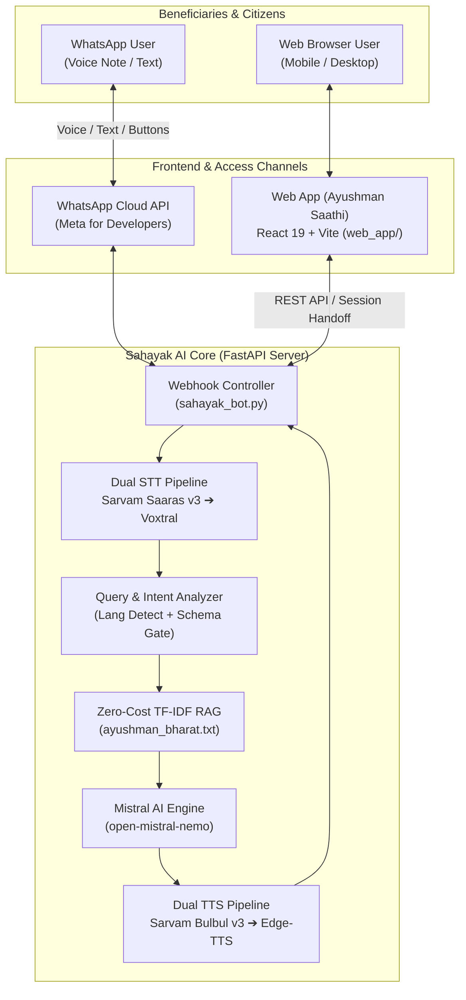

# 🇮🇳 Sahayak AI: Ayushman Bharat (PM-JAY) Multi-Channel Healthcare Assistant

[](https://python.org)
[](https://fastapi.tiangolo.com)
[](https://react.dev)
[](https://vitejs.dev)
[](https://mistral.ai)
[](LICENSE)

**Sahayak AI** is an accessible, multi-channel AI assistant built to bridge the digital and linguistic divide for Indian citizens seeking healthcare benefits under **Ayushman Bharat Pradhan Mantri Jan Arogya Yojana (PM-JAY)** and **Ayushman Vaya Vandana Yojana (70+ Senior Citizens Scheme)**.

The project combines an **omnichannel WhatsApp Voice Bot** and an **interactive voice-guided Web Application (Ayushman Saathi)**, providing conversational guidance, automated eligibility checking, and video/audio walkthroughs in regional Indian languages.

---

## 🏗️ System Architecture



---

## 🌟 Key Highlights & Components

### 1. 🤖 WhatsApp Voice Bot (`sahayak_bot.py`)
- **Voice-In / Voice-Out, Text-In / Text-Out**: Automatically mirrors the citizen's communication preference.
- **5 Indian Languages**: Hindi (`hi`), Marathi (`mr`), Gujarati (`gu`), Bengali (`bn`), and English (`en`).
- **Dynamic Language Detection**: Inspects each message individually, adapting instantly without forcing manual resets.
- **Visual Onboarding**: Sends language-specific explainer videos (`videos/`) upon initial inquiry.
- **Quick Action & CTA Buttons**: Interactive reply buttons for Eligibility, Coverage, Card Issuance, and one-tap web handoff.
- **Terminal CLI Mode**: Built-in testing mode (`--cli`) to simulate voice and text interactions offline without WhatsApp setup.

### 2. 📱 Interactive Web Application (`web_app/`)
- **Voice-Guided Questionnaire**: Step-by-step Hindi audio prompts with automated Web Speech API (TTS) fallback.
- **Senior-Citizen Optimized**: High-contrast, tactile UI designed with accessibility and low digital literacy in mind.
- **WhatsApp Handoff (`?session=<ID>`)**: Continuous session sync between the WhatsApp chat and web questionnaire.
- **Offline & Resilient Fallback Engine**: If the backend is unreachable, the client-side rule engine evaluates eligibility locally without breaking user flow.

### 3. 🧠 Zero-Rate-Limit Knowledge Engine (Local TF-IDF RAG)
- Powered by a local knowledge base (`ayushman_bharat.txt`).
- Uses local TF-IDF retrieval (`embeddings_cache.pkl`) rather than external embedding APIs, eliminating API rate limits and recurring token costs.
- Automatically re-indexes whenever `ayushman_bharat.txt` is updated.

### 4. 🎙️ Redundant Dual Speech Pipelines
- **Speech-to-Text (STT)**: Primary provider **Sarvam Saaras v3** with seamless fallback to **Mistral Voxtral**.
- **Text-to-Speech (TTS)**: Primary provider **Sarvam Bulbul v3** with seamless fallback to **Microsoft Edge-TTS**.
- **FFmpeg Integration**: Automatic transcode between audio formats (OGG/Opus for WhatsApp, WAV for STT).

---

## 📁 Repository Layout

```text
Sahayak-AI/
├── web_app/                    # React 19 + Vite frontend (Ayushman Saathi)
│   ├── public/                 # Static icons and audio assets
│   ├── src/
│   │   ├── components/         # AudioPlayer & UI widgets
│   │   ├── data/               # Questions schema & backend config
│   │   └── pages/              # Welcome, Question, Processing, Result
│   ├── package.json            # Web app dependencies & build scripts
│   └── README.md               # Dedicated web app documentation
├── audio/                      # Audio prompts (e.g. greeting.ogg)
├── videos/                     # Multilingual explainer videos (.mp4)
├── ayushman_bharat.txt         # Scheme knowledge base (source of truth)
├── build_embeddings.py         # Script to pre-compute local TF-IDF index
├── embeddings_cache.pkl        # Serialized TF-IDF vector index
├── requirements.txt            # Python backend dependencies
├── sahayak_bot.py              # Main FastAPI application, webhook & CLI bot
└── README.md                   # Project documentation
```

---

## ⚡ Getting Started

### 1. Prerequisites
- **Python**: Version `3.10` or higher
- **Node.js**: Version `18.0` or higher
- **FFmpeg**: Installed and accessible in your system `PATH`
- **Mistral API Key**: For chat generation and fallback STT
- *(Optional)* **Sarvam API Key**: For natural Indian regional voices and transcription
- *(Optional)* **WhatsApp Cloud API Account**: Via Meta for Developers

---

### 2. Backend Setup

1. **Clone the repository**:
   ```bash
   git clone https://github.com/SambhavJain-22/Sahayak-AI.git
   cd Sahayak-AI
   ```

2. **Create and activate a virtual environment**:
   ```bash
   # Windows (PowerShell)
   python -m venv venv
   .\venv\Scripts\Activate.ps1

   # Linux / macOS
   python3 -m venv venv
   source venv/bin/activate
   ```

3. **Install Python dependencies**:
   ```bash
   pip install -r requirements.txt
   ```

4. **Configure Environment Variables**:
   Create a `.env` file in the root directory:
   ```env
   # Required
   MISTRAL_API_KEY=your_mistral_api_key

   # WhatsApp Cloud API (Required for WhatsApp deployment)
   WHATSAPP_TOKEN=your_whatsapp_cloud_token
   PHONE_NUMBER_ID=your_phone_number_id
   VERIFY_TOKEN=your_custom_webhook_verify_token

   # Optional (Recommended for Indian regional audio)
   SARVAM_API_KEY=your_sarvam_api_key
   SARVAM_TTS_MODEL=bulbul:v3
   SARVAM_SPEAKER=anand
   ELIGIBILITY_WEBSITE_URL=http://localhost:5173
   ```

---

### 3. Frontend Setup (`web_app`)

1. **Navigate to the web app folder**:
   ```bash
   cd web_app
   ```

2. **Install dependencies**:
   ```bash
   npm install
   ```

3. **Configure Frontend Environment**:
   Verify or create `web_app/.env`:
   ```env
   VITE_BACKEND_URL=http://localhost:8000
   ```

4. **Start the development server**:
   ```bash
   npm run dev
   ```
   The web application will be live at `http://localhost:5173`.

---

## 🚀 Running the Bot

### Option A: Terminal CLI Mode (No WhatsApp or Webhook Needed)
Test conversational RAG, speech translation, and responses right in your terminal:

```bash
python sahayak_bot.py --cli
```
- Type plain text to simulate user messages.
- Enter `@path/to/audio.ogg` to feed actual voice recordings.
- Voice outputs are synthesized and saved to `./out/`.

---

### Option B: WhatsApp Webhook Mode
Run the FastAPI production webhook server:

```bash
uvicorn sahayak_bot:app --port 8000 --reload
```

#### Connecting to Meta WhatsApp Cloud API:
1. Expose your local port via tunnel:
   ```bash
   ngrok http 8000
   ```
2. In the [Meta for Developers Portal](https://developers.facebook.com/):
   - Navigate to **WhatsApp > Configuration**.
   - Set **Callback URL** to `https://<your-ngrok-url>/webhook`.
   - Set **Verify Token** to your matching `.env` `VERIFY_TOKEN`.
   - Subscribe to the **`messages`** webhook field.
3. Send a message or voice note to your test WhatsApp number!

---

## 🔒 Security & Data Privacy

- **No Medical Diagnosis**: Sahayak AI provides scheme information, guidelines, and benefits advisory; it explicitly redirects medical inquiries to registered professionals.
- **Deterministic RAG**: Responses are strictly synthesized against `ayushman_bharat.txt`. Unsupported queries trigger an authoritative fallback directing citizens to the national toll-free helpline (`14555`) or official portal.
- **Secrets Management**: Sensitive API keys and tokens must strictly remain in `.env` and are untracked by Git.

---

## 📄 License

This project is licensed under the [MIT License](LICENSE).
