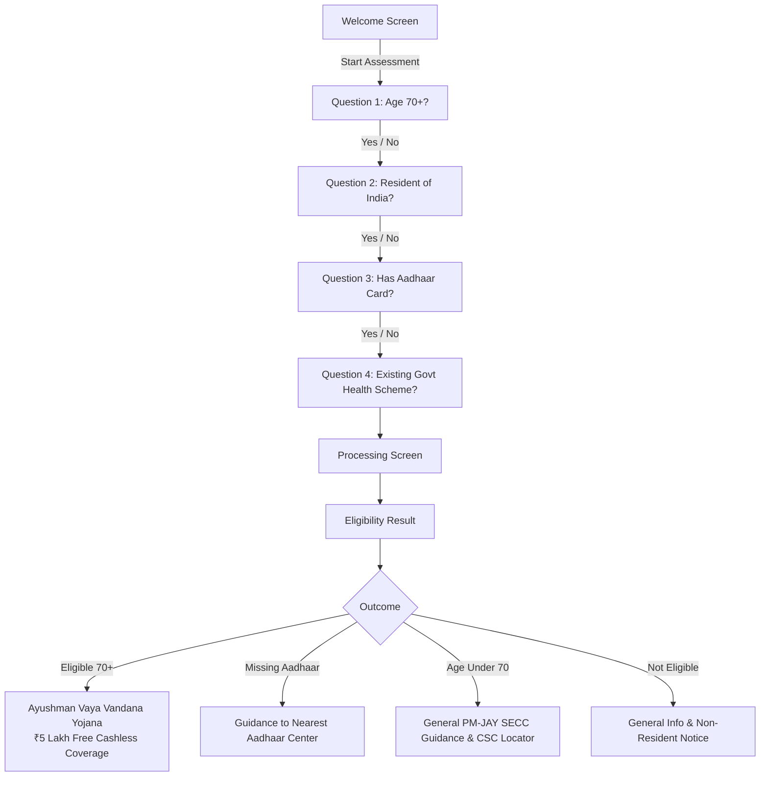

# 🏥 Sahayak AI — Web Application (Ayushman Saathi)

[](https://react.dev/)
[](https://vitejs.dev/)
[](LICENSE)
[]()

**Sahayak AI Web App (Ayushman Saathi)** is an accessible, voice-assisted web application designed to help citizens—especially senior citizens and rural beneficiaries—evaluate their eligibility for government healthcare schemes like **Ayushman Bharat Pradhan Mantri Jan Arogya Yojana (PM-JAY)** and **Ayushman Vaya Vandana Yojana (70+ Senior Citizens Scheme)**.

---

## 🌟 Key Features

- 👴 **Senior Citizen & Rural Friendly UI**: Large touch targets, intuitive visual cues, high-contrast typography, and emoji markers tailored for maximum accessibility.
- 🔊 **Voice & Audio-First Experience**: Built-in voice prompts in Hindi for every question with automatic Web Speech API (TTS) fallback if audio assets are unavailable.
- 📱 **WhatsApp Bot Handoff**: Supports session continuity through URL query parameters (`?session=<ID>`), enabling users to transition smoothly from WhatsApp to the interactive web questionnaire.
- 🔄 **Real-Time Backend Sync**: Communicates seamlessly with the FastAPI backend (`/session`, `/answer`, `/eligibility`) to track sessions and store responses.
- 🛡️ **Offline & Resilient Fallback Engine**: If the backend server is unreachable or offline, the client-side rule evaluation engine automatically computes eligibility without interrupting the user.
- ⚡ **Blazing Fast**: Powered by **React 19** and **Vite** with fast HMR and rapid bundle generation.

---

## 🧭 User Flow & Question Tree



---

## 📂 Project Structure

```text
web_app/
├── .github/
│   └── workflows/
│       └── deploy.yml          # GitHub Actions workflow for GitHub Pages
├── public/
│   ├── audio/                  # Pre-recorded Hindi audio prompts (.mp3)
│   ├── images/                 # Public icons and images
│   ├── favicon.svg             # Application favicon
│   └── icons.svg               # SVG icons bundle
├── src/
│   ├── assets/                 # Component assets (hero image, logos)
│   ├── components/
│   │   └── AudioPlayer.jsx     # Audio playback controller with TTS fallback
│   ├── data/
│   │   └── questions.js        # Data-driven question schema and backend URL config
│   ├── pages/
│   │   ├── Welcome.jsx         # Onboarding & landing screen
│   │   ├── Question.jsx        # Step-by-step interactive questionnaire screen
│   │   ├── Processing.jsx      # Animated calculation & verification screen
│   │   └── Result.jsx          # Scheme benefits, details & next steps
│   ├── App.css                 # Component-level styling
│   ├── App.jsx                 # State management, routing, & offline rule engine
│   ├── index.css               # Design system & mobile-responsive theme
│   └── main.jsx                # Application root entry point
├── .env                        # Environment configuration
├── .gitignore                  # Git ignore rules
├── .oxlintrc.json              # Oxlint linting configuration
├── index.html                  # HTML entry template
├── package.json                # Project dependencies and npm scripts
└── vite.config.js              # Vite bundler configuration
```

---

## 🛠️ Tech Stack

- **Framework**: [React 19](https://react.dev/)
- **Bundler & Tooling**: [Vite](https://vitejs.dev/)
- **Linter**: [Oxlint](https://oxc.rs/)
- **Styling**: Vanilla CSS (Mobile-first, responsive, accessible)
- **Audio / Speech**: HTML5 Audio API + Web Speech API (`speechSynthesis`)

---

## 🚀 Getting Started

### Prerequisites

Ensure you have the following installed:
- [Node.js](https://nodejs.org/) (version 18.0 or higher)
- `npm` or `pnpm` / `yarn`

### Installation

1. Navigate to the `web_app` directory:
   ```bash
   cd web_app
   ```

2. Install dependencies:
   ```bash
   npm install
   ```

### Configuration

Create or modify the `.env` file in the `web_app/` root:

```env
VITE_BACKEND_URL=http://localhost:8000
```

> **Note**: In production, replace `http://localhost:8000` with your deployed backend server URL (e.g. Render, Railway, AWS, or Ngrok tunnel).

### Running in Development

Start the local development server with hot module replacement:

```bash
npm run dev
```

Open your browser and navigate to `http://localhost:5173`.

### Testing WhatsApp Bot Integration

To test the application as if triggered from the WhatsApp bot handoff:

```text
http://localhost:5173/?session=TEST_SESSION_12345
```

The app will read the `session` parameter, synchronize questions and answers to the backend, and finalize the result under that session ID.

### Building for Production

Compile and bundle production-ready static assets:

```bash
npm run build
```

Preview the production build locally:

```bash
npm run preview
```

---

## 🔗 Backend API Integration

The web app interacts with the following FastAPI backend endpoints:

| Endpoint | Method | Description |
| :--- | :--- | :--- |
| `/session` | `POST` | Generates a new session if one was not passed via URL. |
| `/answer` | `POST` | Records the user's selected answer for a specific question ID. |
| `/eligibility` | `POST` | Triggers final eligibility determination based on recorded answers. |

*If the backend cannot be reached, the built-in `localEligibilityCheck` engine seamlessly takes over to ensure zero disruption for the user.*

---

## 🚢 Deployment

### GitHub Pages

A GitHub Actions workflow is included in `.github/workflows/deploy.yml` which deploys the static build upon pushes to `main`.

You can also deploy manually:
```bash
npm run deploy
```

### Vercel / Netlify

1. Link your repository on Vercel or Netlify.
2. Set **Root Directory** to `web_app`.
3. Set **Build Command** to `npm run build`.
4. Set **Output Directory** to `dist`.
5. Add the environment variable `VITE_BACKEND_URL` in the project settings.

---

## 📄 License

This project is licensed under the MIT License.
